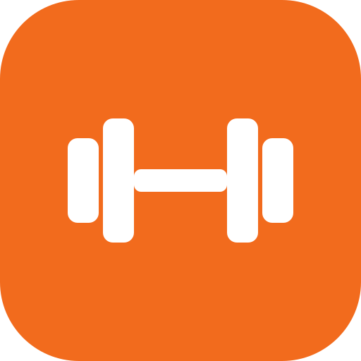
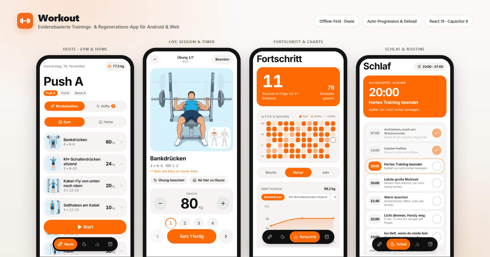
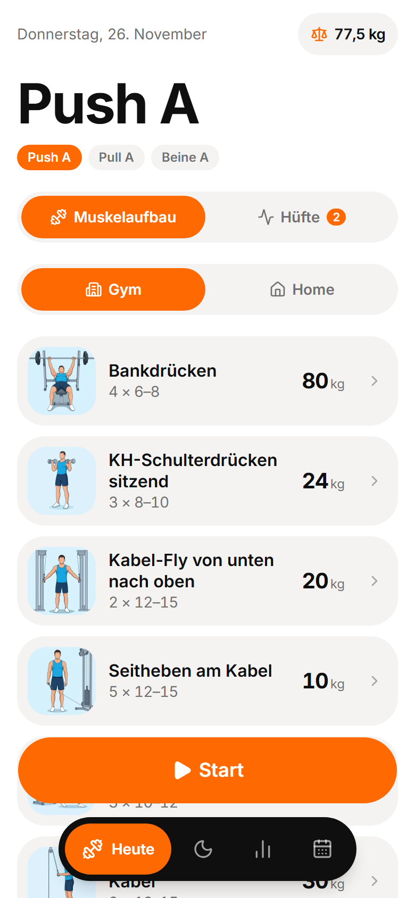
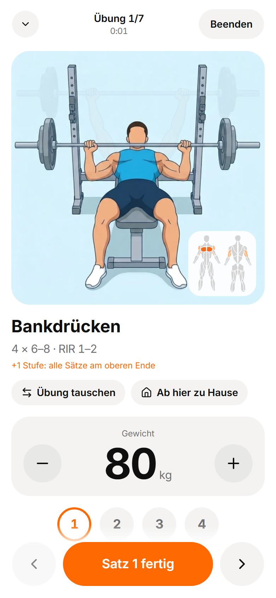
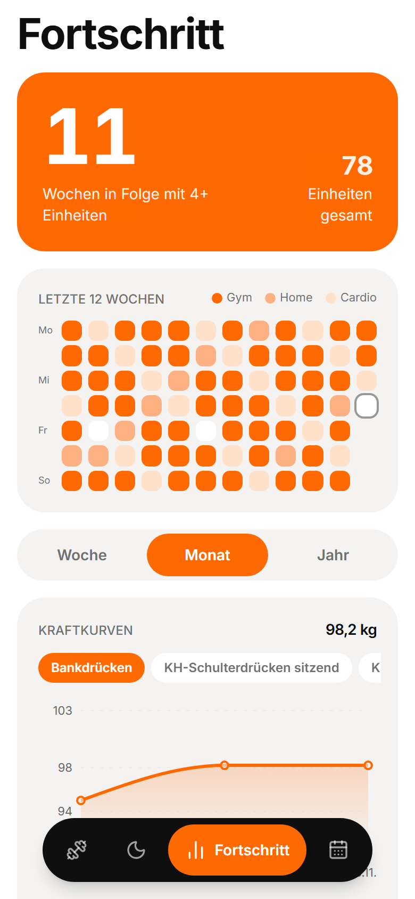
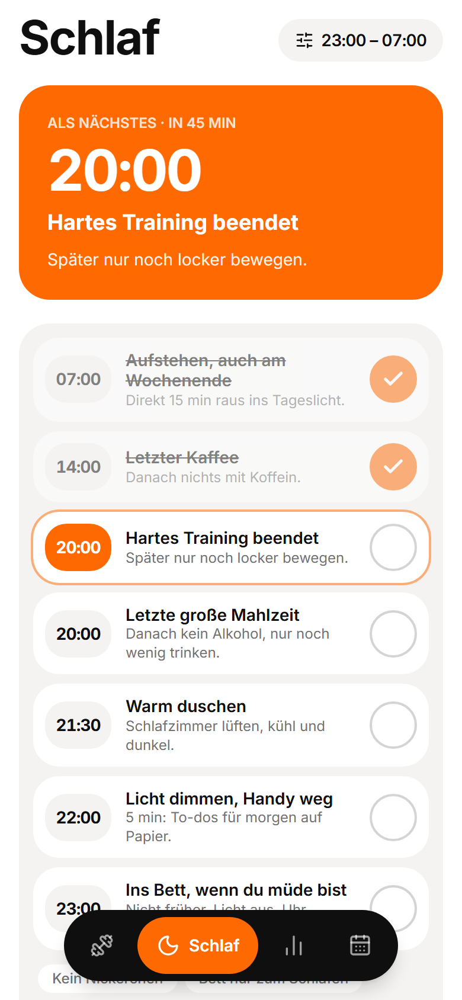
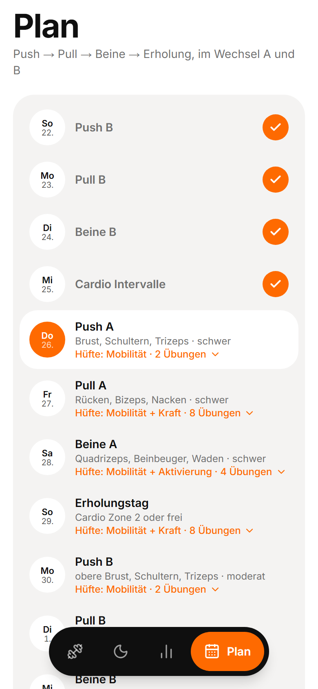
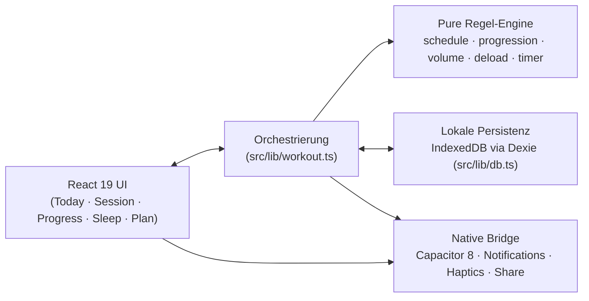

<div align="center">



# Workout

**Evidenzbasierte Offline-First Trainings- & Regenerations-App für Android und Web**

*Öffnen, „Gym“ oder „Home“ wählen, loslegen – mit automatischer Progression, Volumensteuerung, Deload-Erkennung, Schlafroutine und KI-Analyse-Export.*

<p>
  <a href="https://github.com/NicoDev01/workout-app/actions/workflows/ci.yml">
    
  </a>
  
  
  
  
  
  <a href="./LICENSE">
    
  </a>
</p>

<p>
  <a href="https://nicodev01.github.io/workout-app/"><strong>▶ Live-Demo im Browser</strong></a>
  &nbsp;·&nbsp;
  <a href="https://github.com/NicoDev01/workout-app/releases/latest"><strong>⬇ Android APK herunterladen</strong></a>
  &nbsp;·&nbsp;
  <a href="#architektur"><strong>Architektur</strong></a>
  &nbsp;·&nbsp;
  <a href="#lokal-starten"><strong>Lokal starten</strong></a>
</p>

<br />



</div>

---

## Warum dieses Projekt?

Viele Fitness-Apps überladen Nutzer mit Konfigurationsmenüs, Social-Feeds, Cloud-Accounts und Abos. **Workout** verfolgt das Gegenteil: **eine klare, evidenzbasierte Entscheidung pro Tag**.

Die App kennt den Trainingsplan, berechnet Gewichte, Wiederholungen, Volumen und Entlastungswochen automatisch aus den eigenen Trainingsdaten und läuft **100 % lokal auf dem Gerät** (IndexedDB via Dexie) – als Web-App im Browser genauso wie als native Android-App mit Hintergrund-Pausen-Timer und Haptik via Capacitor.

> **Hinweis zu den Screenshots:** Alle Vorschaubilder zeigen die echte App im Mobile-Viewport (`390×844`) mit synthetischen Beispieldaten.

---

## Kernfunktionen

### Trainingssteuerung & Regel-Engine
- **Flexible 8-Tage-Rotation (`Push A → Pull A → Beine A → Zone 2 → Push B → Pull B → Beine B → Intervalle`):** Unabhängig vom Wochentag – ein verpasster Tag verschiebt den Plan nicht, sondern setzt nahtlos bei der nächsten Einheit fort.
- **Gym & Home nahtlos kombiniert:** Für jede Übung sind Gym-, Home- (Körpergewicht/Rucksack), optionale Kurzhantel- und alternative Gym-Gerätevarianten hinterlegt. Sogar mitten in einer laufenden Session lässt sich auf „Ab hier zu Hause“ wechseln oder eine belegte Maschine tauschen.
- **Automatische Progression & Satz-Kalibrierung:**
  - Doppelprogression mit gerätespezifischen Gewichtsschritten (`2,5 kg` Langhantel/Kabel/BW/Rucksack, `2 kg` Kurzhantel, `5 kg` Maschine).
  - Epley-1RM-basierte **Live-Nachjustierung** für den nächsten Satz, wenn ein Satz klar außerhalb des Ziel-Wiederholungs- oder RIR-Bereichs lag.
  - Automatische Aufwärmsätze (`50 % × 8`, `75 % × 4`) und kontrollierter Reset (`−7,5 %`) nach zweimaligem Verfehlen der Untergrenze.
- **Volumensteuerung, Auto-Deload & Wiedereinstieg:**
  - Muskelvolumen-Bilanzierung (Primärmuskel `1,0`, Sekundärmuskel `0,5` Sätze) mit automatischem `+1`-Satz-Bonus alle 14 Tage pro wachsendem Muskel im Korridor von `10–20` Sätzen/Woche.
  - Automatische **Entlastungswoche** (halbe Sätze, `RIR 3`), sobald mindestens zwei Grundübungen über drei Einheiten bei gleicher Last abfallen.
  - Automatische **Wiedereinstiegswoche** (`−10 %` Last) nach 7 oder mehr Tagen Pause.

### Live-Session & Native Android-Funktionen
- **Geführter Trainingsmodus:** Animierte Start-/Endposen-Schleife pro Übung, anatomische Muskel-Heatmap (`react-body-highlighter`), schneller Gewicht-Stepper und RIR-Erfassung.
- **Zuverlässiger Pausen-Timer:** Läuft mit Web-Audio-Signal im Browser und nativen **Android Local Notifications** (klingelt auch bei gesperrtem Display), kombiniert mit Haptik (`@capacitor/haptics`) und `KeepAwake`.
- **Geführte Cardio-Sessions:** Phasen-Timer für Zone-2-Ausdauer und `4 × 4 min`-Intervalle inkl. Auf- und Abwärmen.

### Fortschritt, Schlaf & Prävention
- **Fortschritt & Auswertung:** Wochen-Streak-Anzeige, 12-Wochen-Aktivitäts-Heatmap (Gym / Home / Cardio), e1RM-Kraftkurven (Recharts), geschätzter Alters-/Kraftnormvergleich, Körpergewichtskurve, Muskelvolumen-Diagramm und Cardio-Minuten.
- **CBT-I-inspirierte Schlafroutine:** Zeitplan von Aufstehzeit/Tageslicht bis Schlafenszeit (inkl. Koffein-Cutoff, Trainingsschluss, Abdunkeln), lokale Erinnerungen, Abend-/Nacht-Ansicht, Trainingsempfehlung aus Schlafdaten und Schlafkompressions-Hinweis.
- **Optionales Hüft-Programm:** Tägliche Mobilitäts-, Aktivierungs- und Kräftigungsblöcke bei schnappender Hüfte sowie automatischer Ersatz risikoreicher Bauchübungen durch `Dead Bug`.

### Datenschutz, Backup & KI-Export
- **Offline-First & Zero Tracking:** Alle Daten liegen ausschließlich lokal in IndexedDB (`Dexie`). Kein Login, kein Server, keine Telemetrie.
- **JSON-Backup & KI-Markdown-Export:** Vollständiger Backup-Export/-Import sowie ein strukturierter **Markdown-Export**, der Plan, Historie, Volumen, Körpergewicht, Hüft- und Schlafdaten direkt auswertungsfertig für LLMs aufbereitet (Android Share Sheet / Browser-Download).

---

## Weitere Ansichten

<div align="center">
<table>
  <tr>
    <td align="center" width="20%">
      <br />
      <sub><b>Heute</b> · Gym/Home & Zielgewichte</sub>
    </td>
    <td align="center" width="20%">
      <br />
      <sub><b>Session</b> · Posen, Muskelmap & Sätze</sub>
    </td>
    <td align="center" width="20%">
      <br />
      <sub><b>Fortschritt</b> · Streak, Heatmap & e1RM</sub>
    </td>
    <td align="center" width="20%">
      <br />
      <sub><b>Schlaf</b> · Tagesplan & Checkliste</sub>
    </td>
    <td align="center" width="20%">
      <br />
      <sub><b>Plan</b> · Rotation, Bonus & KI-Export</sub>
    </td>
  </tr>
</table>
</div>

---

## Architektur

Die Trainings- und Regenerationsregeln sind bewusst als **reine, seiteneffektfreie TypeScript-Module** ohne UI- oder Datenbank-Abhängigkeit umgesetzt und durch **45 Vitest-Unit-Tests** ([`src/lib/logic.test.ts`](./src/lib/logic.test.ts)) abgesichert.



### Projektstruktur

```text
├── src/
│   ├── data/          # Trainingsplan als Code (plan.ts), Übungskatalog, Schlaf-, Hüft- & Normdaten
│   ├── lib/           # Pure Logik (schedule, progression, volume, deload, timer), Dexie-DB,
│   │                  # Backup, KI-Markdown-Export, Capacitor-Wrapper & 45 Unit-Tests
│   ├── screens/       # Today, Session, CardioSession, Progress, Sleep, Plan
│   ├── components/    # Wiederverwendbare UI-Bausteine, shadcn/ui, Charts, Muskelmap, BottomNav
│   └── hooks/         # Zeit-Hook für Live-Timer und Tagesroutine
├── public/ex/         # Zugeschnittene In-App-Übungsillustrationen (WebP/JPG)
├── scripts/           # Build-Skript zum Zuschneiden von Übungsdaten (build-exercises.ts)
├── android/           # Capacitor-8-Android-Projekt (Gradle)
└── .github/workflows/ # CI (Lint, Typecheck, Tests, Build) & GitHub Pages Live-Demo
```

---

## Tech-Stack

| Bereich | Technologien |
| --- | --- |
| **Frontend** | React 19, TypeScript 6, Vite 8 |
| **UI & Animation** | Tailwind CSS 4, shadcn/ui (`@base-ui/react`), Lucide Icons, Motion, Sonner |
| **Charts & Visualisierung** | Recharts 3, `react-body-highlighter` |
| **Lokale Datenbank** | Dexie 4 (IndexedDB) + `dexie-react-hooks` |
| **Mobile / Native** | Capacitor 8 (Android, Local Notifications, Haptics, Filesystem, Share, KeepAwake) |
| **Qualitätssicherung** | Vitest 5 (45 Unit-Tests), ESLint 10, TypeScript Strict Check, Prettier, GitHub Actions |

---

## Lokal starten

**Voraussetzungen:** Node.js `>= 22` (empfohlen `24`), npm.

```bash
git clone https://github.com/NicoDev01/workout-app.git
cd workout-app
npm install
npm run dev
```

### Wichtige Befehle

| Befehl | Beschreibung |
| --- | --- |
| `npm run dev` | Startet den Vite-Entwicklungsserver |
| `npm test` | Führt alle 45 Unit-Tests der Trainingslogik aus (Vitest) |
| `npm run typecheck` | Prüft Typen mit `tsc --noEmit` |
| `npm run lint` | Prüft Code-Qualität mit ESLint |
| `npm run build` | Baut das optimierte Produktions-Bundle in `dist/` |
| `npm run apk` | Baut Web-Bundle, synchronisiert Capacitor und erzeugt die Android-Debug-APK (`android/app/build/outputs/apk/debug/app-debug.apk`, benötigt JDK/Android SDK) |

---

## Lizenzen & Datenquellen

- **Quellcode:** Lizenziert unter der [MIT-Lizenz](./LICENSE).
- **Übungsdaten & Illustrationen:** Exercise data by [RepDB](https://repdb.co) (RepDB Free Tier License – Nutzung innerhalb der App mit Attribution; die Rohdatenbank ist bewusst nicht Bestandteil dieses Repositories).
- **Sissy-Squat-Bilder:** `free-exercise-db` (Public Domain).
